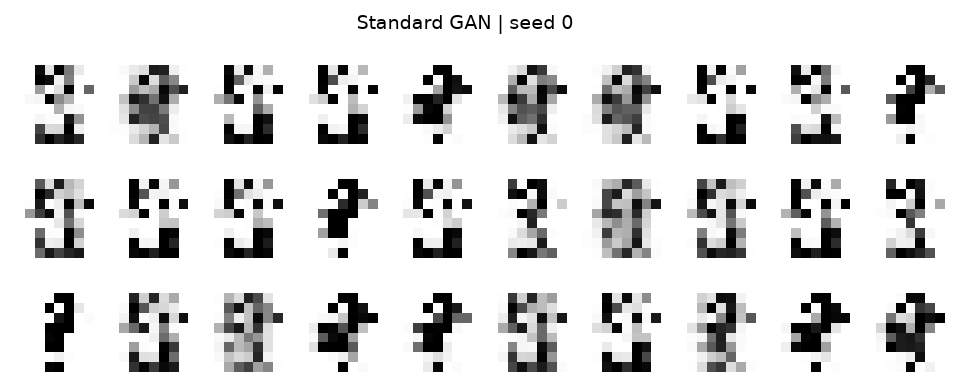
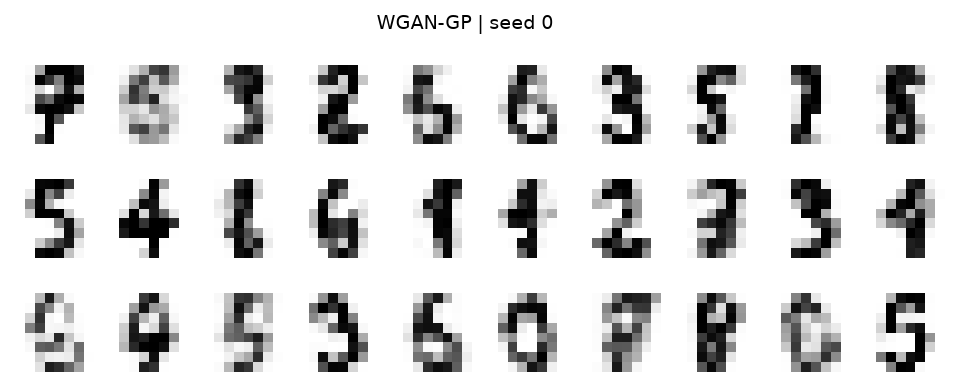
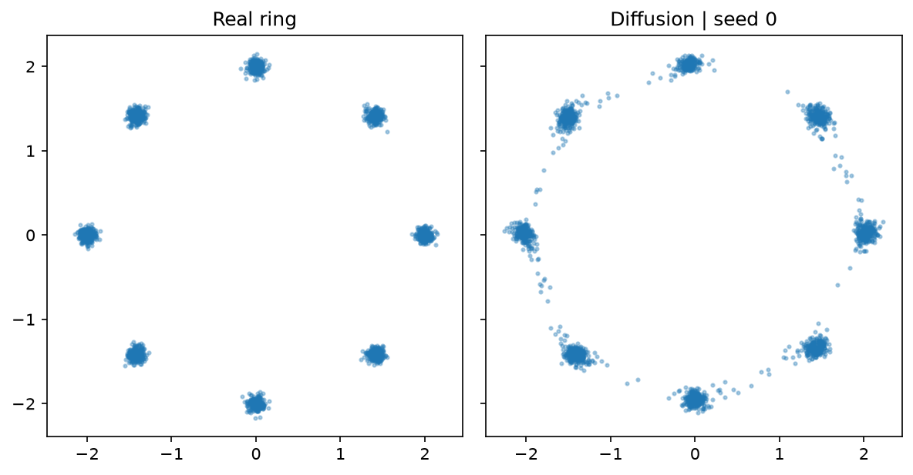
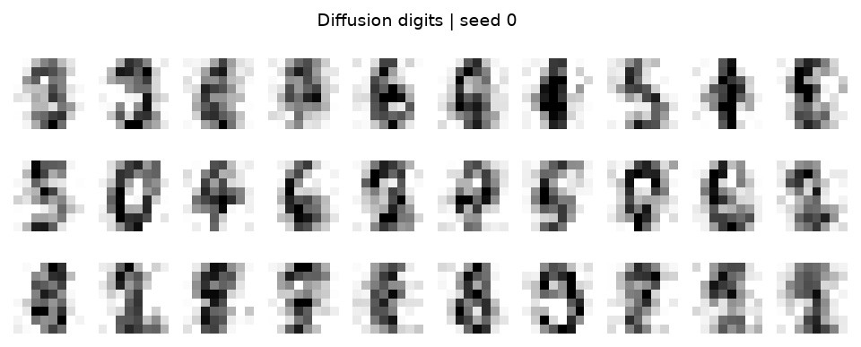
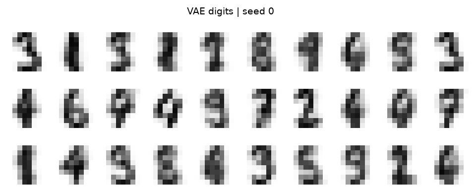

# AIGC-5500 Lab 8 - Two Ways to Generate

**Student:** Daniel Alejandro Castillo Martin  
**Student ID:** N10019284  
**Course:** Advanced Deep Learning (AIGC-5500-0NA)  
**Professor:** Hossein Pourmodheji

---

Lab 08 submission for **Advanced Deep Learning (AIGC-5500)** in the Artificial Intelligence with Machine Learning postgraduate program at Humber Polytechnic.

This lab implements GAN objectives and a diffusion process in PyTorch, verifies them against known results, and compares standard GAN, WGAN-GP, diffusion, and a variational autoencoder (VAE) on 8 × 8 digit images.

## 1. Setup

Use Python 3.14.6 and a Jupyter-compatible notebook environment. Dependencies are listed in `requirements.txt`, including PyTorch, NumPy, SciPy, scikit-learn, and Matplotlib.

```powershell
git clone https://github.com/dancmartin11/aigc-5500-lab-08-two-ways-to-generate.git
cd aigc-5500-lab-08-two-ways-to-generate
python -m venv .venv
.\.venv\Scripts\Activate.ps1
python -m pip install -r requirements.txt
```

On Linux or macOS, from the cloned repository:

```bash
python3 -m venv .venv
source .venv/bin/activate
python -m pip install -r requirements.txt
```

## 2. Project Structure

```text
aigc-5500-lab-08-two-ways-to-generate/
├── docs/
│   └── AIGC5500_Lab08.pdf
├── scripts/
│   └── lab08_starter.py
├── src/
│   ├── __init__.py
│   ├── diffusion.py
│   └── gan.py
├── output/
│   ├── diffusion_digit_samples.png
│   ├── diffusion_ring.png
│   ├── standard_gan_samples.png
│   ├── vae_digit_samples.png
│   └── wgan_gp_samples.png
├── daniel_alejandro_castillo_martin_LAB8.ipynb
├── .gitignore
├── README.md
└── requirements.txt
```

The starter provides the datasets, model architectures, VAE baseline, and scoring helpers. The `src/` package implements the GAN objectives and training, the diffusion forward process and training loss, and both reverse samplers. The notebook runs the checks and experiments.

## 3. Run

From the repository root, run the starter check.

```powershell
python scripts/lab08_starter.py
```

The starter prints the split shapes and baseline scores and writes `starter_check.png` in the current directory. Open `daniel_alejandro_castillo_martin_LAB8.ipynb` in VS Code or Jupyter, select the `.venv` kernel, and run all cells in order from the repository root. The notebook writes the experiment figures to `output/`.

| Lab piece | Notebook section |
|---|---|
| Verify GAN losses, the optimal discriminator, and gradient saturation | 2. GAN |
| Compare standard GAN and WGAN-GP on digits | 3. Mode Collapse and WGAN-GP |
| Verify forward diffusion and train on the ring and digits | 4. Diffusion |
| Separate the effects of sampling steps and sampler choice | 5. Sampling Steps and Sampler Choice |
| Compare WGAN-GP, diffusion, and VAE | 6. Compare the Three Model Families |

## 4. Hardware and Reproducibility

| Component | Configuration |
|---|---|
| Operating system | Windows |
| Python | 3.14.6 |
| PyTorch | 2.15.0+cpu |
| Training device | CPU |
| CPU model | Intel Core Ultra 7 155U |
| Full notebook wall-clock runtime | ~8 minutes |
| Sum of reported training times | About 8 min 11 s across the standard GAN, WGAN-GP, ring and digits diffusion, and VAE runs |

The sum uses the final comparison table when a timing appears in two places. It excludes verification, feature-network training, scoring, sampling, and plotting.

| Experimental setting | Value |
|---|---|
| Dataset | scikit-learn Digits, 8 × 8 pixels flattened to 64 values |
| Training / test images | 1,438 / 359 |
| Data split / training seeds | 0 / 0, 1, 2 |
| Generated digits per run | 359 |
| GAN comparison | 4,000 generator steps, batch size 128, latent width 16, hidden width 128 |
| Standard GAN | Non-saturating loss, one discriminator update per generator step, Adam learning rates 0.0005 for the generator and 0.0002 for the discriminator |
| WGAN-GP | Three critic updates per generator step, gradient penalty weight 10, Adam learning rate 0.0005 for both networks |
| GAN Adam beta values | 0.5 and 0.999 |
| Diffusion | 100-step schedule, 4,000 training updates per run, batch size 128 |
| Ring denoiser | Hidden width 128 and learning rate 0.002 |
| Digits denoiser | Hidden width 256 and cosine decay from 0.001 to zero |
| VAE baseline | 200 epochs, batch size 64, learning rate 0.002, latent width 8 |

Every Fréchet comparison uses 359 generated images and the same feature network trained on the real training split. The held-out test images provide the reference features. Diffusion uses training pixels in [-1, 1] and maps generated pixels back to [0, 1] before scoring.

## 5. Prediction (Before the GAN Comparison)

I expect WGAN-GP to achieve higher recall and cover more digit classes than the standard GAN across the three seeds. I expect the standard GAN's predicted digit counts to be more concentrated in a few classes, with some classes rare or absent. The gradient penalty encourages the critic's scores to change smoothly between real and generated samples, which may give the generator a more useful signal for covering a wider variety of digits.

## 6. Results

### 6.1 GAN Verification

| Check | Recorded output |
|---|---|
| Discriminator loss vs. its probability formula | PASS, absolute difference 2.22e-16 |
| Original generator loss vs. its probability formula | PASS, absolute difference 1.11e-16 |
| Non-saturating generator loss vs. its probability formula | PASS, absolute difference 0.00e+00 |
| Trained vs. optimal discriminator on [-2, 3.5] | Maximum absolute difference 0.026696 |
| Mean probability assigned to shifted generator samples | 1.587712e-09 |
| Original generator loss mean gradient norm | 9.257525e-09 |
| Non-saturating generator loss mean gradient norm | 5.844011e+00 |

The discriminator assigned the shifted generator samples a probability close to zero. The original objective gave nearly vanishing gradients there, while the non-saturating objective still gave a strong gradient.

### 6.2 Standard GAN vs. WGAN-GP

A linear critic with gradient norm 1.0 produced penalty 0.0 (PASS). A linear critic with gradient norm 3.0 produced penalty 4.0 (PASS).

| Model | Seed | Fréchet | Precision | Recall | Digits present | Predicted counts, digits 0–9 |
| --- | --- | --- | --- | --- | --- | --- |
| Standard GAN | 0 | 184.5106 | 0.3148 | 0.0000 | 5/10 | 56, 0, 0, 24, 112, 50, 0, 0, 117, 0 |
| WGAN-GP | 0 | 4.1609 | 0.8134 | 0.9109 | 10/10 | 36, 37, 37, 46, 33, 31, 46, 23, 39, 31 |
| Standard GAN | 1 | 93.6530 | 0.4847 | 0.0028 | 8/10 | 70, 55, 33, 52, 79, 56, 2, 0, 12, 0 |
| WGAN-GP | 1 | 4.6852 | 0.7772 | 0.9136 | 10/10 | 35, 33, 32, 32, 41, 38, 38, 46, 34, 30 |
| Standard GAN | 2 | 120.6648 | 0.5627 | 0.0000 | 7/10 | 114, 0, 62, 29, 0, 22, 26, 0, 33, 73 |
| WGAN-GP | 2 | 4.4279 | 0.7967 | 0.9136 | 10/10 | 44, 34, 30, 26, 50, 35, 29, 30, 49, 32 |

| Seed | Gradient norm, first 100 | Gradient norm, last 500 | Score gap, first 100 | Score gap, last 500 |
|---:|---:|---:|---:|---:|
| 0 | 1.0051 | 1.0086 | 1.2298 | 0.2890 |
| 1 | 1.0005 | 1.0089 | 1.1210 | 0.2988 |
| 2 | 1.0029 | 1.0086 | 1.1585 | 0.2955 |

WGAN-GP covered all ten predicted classes and had higher recall across all seeds, supporting the prediction. The standard GAN reached 5–8 classes with recall at or below 0.0028. The critic gradient norm stayed close to 1, and the mean real-minus-generated score gap decreased in every seed. The experiment compares the complete training configurations, including their update ratios and learning rates.





### 6.3 Diffusion Verification and Training

| Completed steps | Chain mean | Chain SD | Direct mean | Direct SD |
|---:|---:|---:|---:|---:|
| 10 | 1.4648 | 0.2140 | 1.4662 | 0.2130 |
| 50 | 0.7993 | 0.8463 | 0.7998 | 0.8476 |
| 99 | 0.1183 | 1.0010 | 0.1152 | 0.9931 |

The forward check starts with 100,000 values of 1.5. The largest difference between the chain and closed-form draws was 0.0031 for the mean and 0.0079 for the standard deviation. The loss and sampler smoke test returned MSE 0.9963 and 16 finite two-dimensional samples. The final schedule step retained 7.50% of the original signal amplitude.

| Seed | Ring modes covered | Ring samples near a mode | Digits MSE, first 100 steps | Digits MSE, last 200 steps |
|---:|---:|---:|---:|---:|
| 0 | 8/8 | 96.3% | 0.6248 | 0.1843 |
| 1 | 8/8 | 96.1% | 0.6332 | 0.1853 |
| 2 | 8/8 | 95.1% | 0.6313 | 0.1845 |

The ring model covered all eight modes in every run, with some samples between clusters. Digits training lowered noise-prediction MSE across all seeds. The ancestral digits scores are included in the next two sections.





### 6.4 Sampling Steps and Sampler Choice

Each sampler uses the same trained denoiser and starting noise within a seed.

| Seed | Sampler | Evaluations | Fréchet | Precision | Recall |
| --- | --- | --- | --- | --- | --- |
| 0 | Ancestral | 100 | 11.2151 | 0.8162 | 0.8524 |
| 0 | Deterministic | 5 | 7.0152 | 0.7827 | 0.9081 |
| 0 | Deterministic | 10 | 7.0755 | 0.7716 | 0.8969 |
| 0 | Deterministic | 25 | 7.8903 | 0.7688 | 0.8997 |
| 0 | Deterministic | 50 | 8.1112 | 0.7660 | 0.8969 |
| 0 | Deterministic | 100 | 8.2320 | 0.7577 | 0.8942 |
| 1 | Ancestral | 100 | 13.5635 | 0.7688 | 0.8162 |
| 1 | Deterministic | 5 | 15.8202 | 0.7214 | 0.9164 |
| 1 | Deterministic | 10 | 13.1537 | 0.7242 | 0.9192 |
| 1 | Deterministic | 25 | 12.8540 | 0.7270 | 0.9415 |
| 1 | Deterministic | 50 | 12.9181 | 0.7270 | 0.9387 |
| 1 | Deterministic | 100 | 12.9639 | 0.7242 | 0.9387 |
| 2 | Ancestral | 100 | 13.3217 | 0.7939 | 0.8273 |
| 2 | Deterministic | 5 | 10.2180 | 0.7549 | 0.9109 |
| 2 | Deterministic | 10 | 10.3349 | 0.7437 | 0.8914 |
| 2 | Deterministic | 25 | 10.4979 | 0.7521 | 0.8747 |
| 2 | Deterministic | 50 | 10.6582 | 0.7493 | 0.8747 |
| 2 | Deterministic | 100 | 10.7412 | 0.7465 | 0.8830 |

Recall changes below are in percentage points. Sampler change compares both methods at 100 evaluations. Step-count change compares each shorter deterministic run with the 100-step deterministic run.

| Seed | Deterministic evaluations | Sampler change | Step-count change | Total change vs. ancestral |
| --- | --- | --- | --- | --- |
| 0 | 5 | +4.18 | +1.39 | +5.57 |
| 0 | 10 | +4.18 | +0.28 | +4.46 |
| 0 | 25 | +4.18 | +0.56 | +4.74 |
| 0 | 50 | +4.18 | +0.28 | +4.46 |
| 1 | 5 | +12.26 | -2.23 | +10.03 |
| 1 | 10 | +12.26 | -1.95 | +10.31 |
| 1 | 25 | +12.26 | +0.28 | +12.53 |
| 1 | 50 | +12.26 | +0.00 | +12.26 |
| 2 | 5 | +5.57 | +2.79 | +8.36 |
| 2 | 10 | +5.57 | +0.84 | +6.41 |
| 2 | 25 | +5.57 | -0.84 | +4.74 |
| 2 | 50 | +5.57 | -0.84 | +4.74 |

Changing samplers at 100 steps raised recall by 4.18–12.26 points and lowered precision in every seed. Shortening the deterministic schedule changed recall by −2.23 to +2.79 points, depending on the seed and step budget. Five evaluations reduced the evaluation count by 95% and increased recall over the ancestral baseline in every seed. For seed 1, its Fréchet distance increased from 13.5635 to 15.8202, which shows that the recall gain came with a trade-off.

### 6.5 Three-Family Comparison

Diffusion here uses the 100-step ancestral sampler. Digit TV is the total variation distance between the predicted generated digit proportions and the true test digit proportions. Mean and minimum nearest-training distances use Euclidean pixel distances.

| Model | Seed | Fréchet | Precision | Recall | Digit TV |
| --- | --- | --- | --- | --- | --- |
| WGAN-GP | 0 | 4.1609 | 0.8134 | 0.9109 | 0.0975 |
| Diffusion | 0 | 11.2151 | 0.8162 | 0.8524 | 0.1031 |
| VAE | 0 | 13.9586 | 0.9136 | 0.4930 | 0.1226 |
| WGAN-GP | 1 | 4.6852 | 0.7772 | 0.9136 | 0.0808 |
| Diffusion | 1 | 13.5635 | 0.7688 | 0.8162 | 0.0947 |
| VAE | 1 | 13.5713 | 0.8802 | 0.4345 | 0.1393 |
| WGAN-GP | 2 | 4.4279 | 0.7967 | 0.9136 | 0.1337 |
| Diffusion | 2 | 13.3217 | 0.7939 | 0.8273 | 0.1504 |
| VAE | 2 | 15.6522 | 0.8858 | 0.4652 | 0.1476 |

Sampling time covers drawing the full batch of 359 samples. Each evaluation is one network pass over that batch.

| Model | Seed | Mean nearest | Minimum nearest | Train (s) | Draw (s) | Evaluations |
| --- | --- | --- | --- | --- | --- | --- |
| WGAN-GP | 0 | 1.3073 | 0.5980 | 91.29 | 0.0015 | 1 |
| Diffusion | 0 | 1.4573 | 0.9545 | 22.19 | 0.2491 | 100 |
| VAE | 0 | 1.1387 | 0.5648 | 13.63 | 0.0054 | 1 |
| WGAN-GP | 1 | 1.3186 | 0.5866 | 80.75 | 0.0029 | 1 |
| Diffusion | 1 | 1.4800 | 0.9490 | 21.63 | 0.1767 | 100 |
| VAE | 1 | 1.1415 | 0.6463 | 13.77 | 0.0008 | 1 |
| WGAN-GP | 2 | 1.3168 | 0.6610 | 78.11 | 0.0018 | 1 |
| Diffusion | 2 | 1.4657 | 0.8207 | 21.11 | 0.2080 | 100 |
| VAE | 2 | 1.1355 | 0.5819 | 15.41 | 0.0007 | 1 |



## 7. Conclusion

**WGAN-GP** was the strongest choice for producing diverse digits quickly after training in the three-family comparison. It had the lowest Fréchet distance (4.16–4.69), highest recall (0.9109–0.9136), and lowest digit TV (0.0808–0.1337) in every seed. It drew the batch in one evaluation, with the highest training cost at 78.11–91.29 seconds per run.

**Diffusion** was the choice when the sampling budget needed to be adjustable. It trained in 21.11–22.19 seconds, and the five-evaluation deterministic runs reached recall of 0.9081–0.9164. The 100-step ancestral sampler took 0.1767–0.2491 seconds per batch, and its Fréchet distance was higher than WGAN-GP's across all seeds.

**The VAE** was suitable as a baseline for quick retraining. It trained in 13.63–15.41 seconds and had the highest precision (0.8802–0.9136). Its recall was lowest (0.4345–0.4930), so it covered less of the held-out feature distribution.

## 8. Known Limitations

The results use 8 × 8 digits, small networks, one data split and feature network, fixed training budgets for each configuration, and three seeds. Predicted digit counts depend on the classifier. Pixel-space nearest-training distance measures similarity to training images and cannot establish memorization on its own. The GAN comparison varies the objective, the update ratio, and the discriminator learning rate together. Timing reflects one local setup and single measured sample batches.

## 9. Repository

[Lab 08 on GitHub](https://github.com/dancmartin11/aigc-5500-lab-08-two-ways-to-generate)
